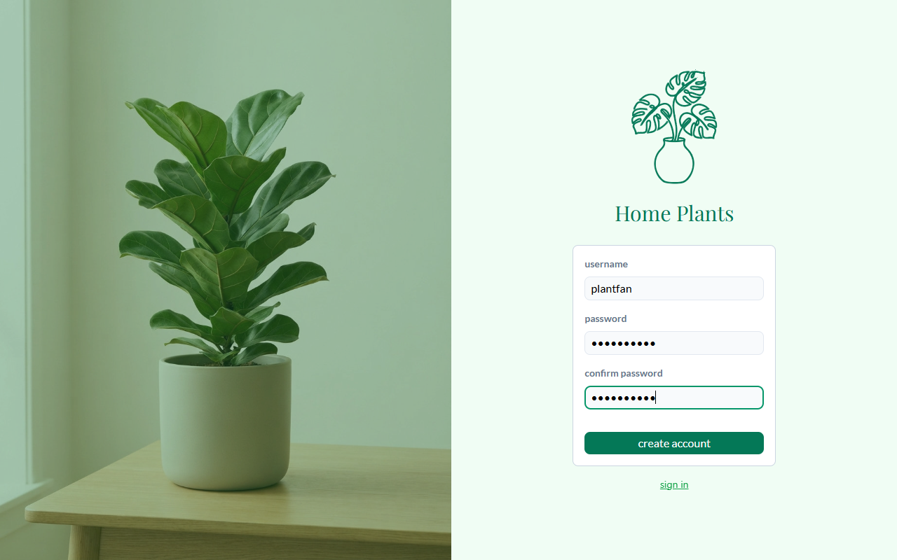
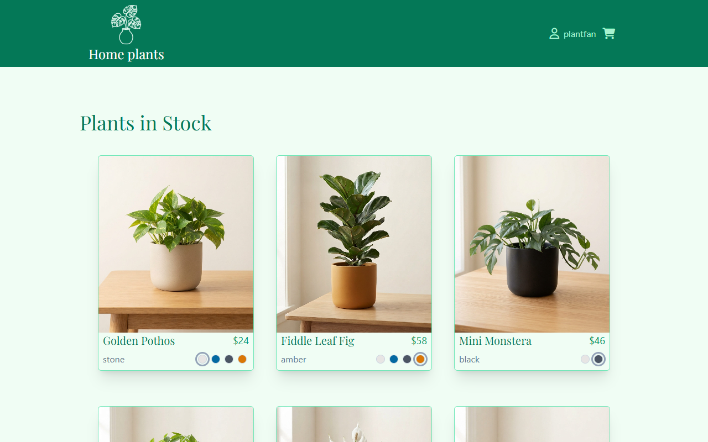
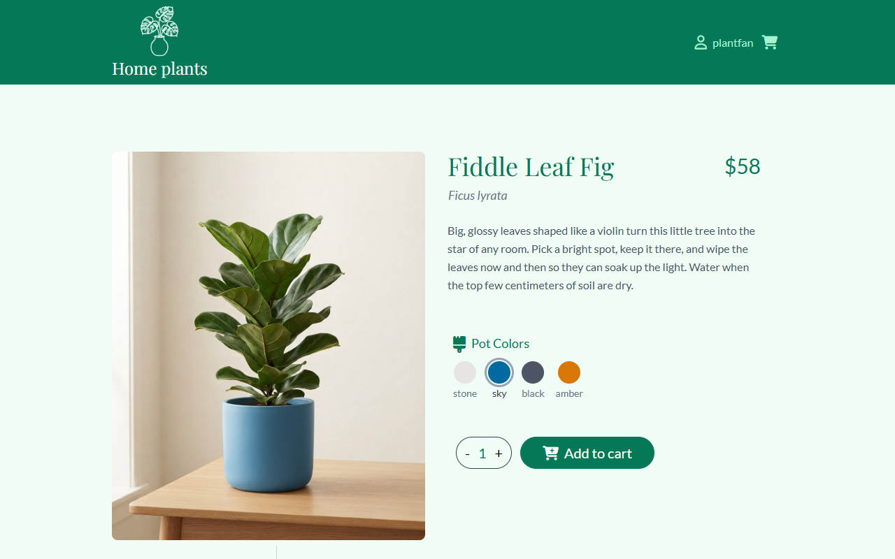
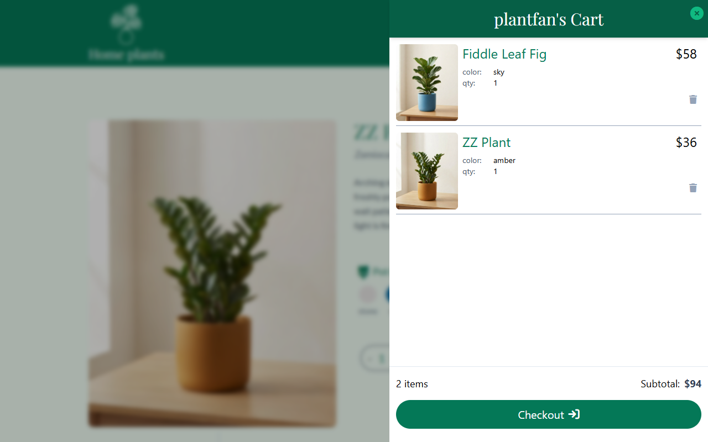

# 🌱 Flowers Shop - Plant E-Commerce Website

A modern plant e-commerce application built with React and Tailwind CSS that allows users to explore available plants, view detailed product information, customize selections, and manage their shopping cart.

The application provides a smooth and interactive shopping experience with responsive design, animations, user authentication, and dynamic cart functionality.

### Create account



### Plant List



### Plant Details



### Shopping Cart



## 🚀 Features

## 🔐 User Authentication

- Users can create a new account and sign in.
- Authentication is handled using JWT tokens.
- Registered users can access available plants currently in stock.
- Provides a personalized shopping experience.

## 🌿 Plant Catalog

- Browse available plants with a clean and modern interface.
- Display plants dynamically from the application data source.
- Smooth scrolling experience with interactive animations.
- Responsive design optimized for desktop, tablet, and mobile devices.

## 🌱 Plant Details Page

Users can view detailed information about each plant:

- Plant name and description
- Product images with zoom functionality
- Available pot colors
- Ability to select different product options
- Ability to choose quantity before adding to cart

## 🛒 Shopping Cart

Users can manage their shopping experience:

- Add multiple plants to the cart
- Add different quantities of the same plant
- View all selected products
- Display:
  - Total number of items
  - Cart subtotal price
  - Product details
- Remove items from the cart

# 🛠️ Technologies Used

## Front-End

- **React 19**
- **JavaScript (ES6+)**
- **Tailwind CSS**
- **Vite**

## Back-End

- **REST API** on **Vercel Serverless Functions** (Node.js), in the [`api/`](./api) folder
- **PostgreSQL** on **Neon** — tables `users`, `plants`, `plant_images`, `cart_items`
- **bcrypt** password hashing and **JWT** sessions (7-day expiry)
- Embedded Postgres (**PGlite**) for local development, so no account is needed to run it

# 🔌 API

| Method   | Endpoint                     | Auth | Description                              |
| -------- | ---------------------------- | ---- | ---------------------------------------- |
| `POST`   | `/api/users`                 |      | Create an account                        |
| `POST`   | `/api/users/session`         |      | Sign in, returns `{ session_token }`     |
| `GET`    | `/api/plants`                |      | All plants with their pot-color images   |
| `GET`    | `/api/plants/:id`            |      | One plant                                |
| `GET`    | `/api/cart`                  | ✓    | The signed-in user's cart                |
| `POST`   | `/api/cart/plants/:plantId`  | ✓    | Add `{ quantity, pot_color }` to cart    |
| `DELETE` | `/api/cart/:id`              | ✓    | Remove a cart item                       |

Authenticated requests send `Authorization: Bearer <session_token>`.

# 💻 Run Locally

```bash
npm install
npm run dev:api   # terminal 1 – API on http://localhost:3001 with a local database
npm run dev       # terminal 2 – app on http://localhost:5173 (proxies /api)
```

The local database is stored in `.local-db/` and filled from [`data/plants.json`](./data/plants.json).

# 🚀 Deploy (Vercel + Neon)

1. In the Vercel project: **Storage → Create Database → Neon (Postgres)** and connect it. This adds `DATABASE_URL`.
2. Add an environment variable `JWT_SECRET` with a long random value.
3. Copy the connection string from the Neon dashboard (**Connect**) into a file named `.env.local` as `DATABASE_URL=...`, then create the tables and load the plants once:
   ```bash
   npm run db:seed
   ```
4. Push to GitHub — Vercel builds the app and deploys the `api/` functions together.

# 🎨 Images

The logo and plant pictures were generated with Google Gemini from text descriptions; the logo was then traced to SVG. The shop, its prices and its products are fictional.
